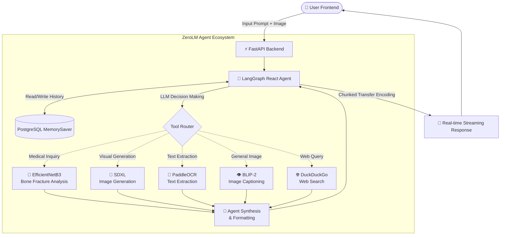

# ZeroLM: An Orchestrator AI Agent for Specialized Deep Learning Execution
**Comprehensive Technical & Research Report**

---

## 1. Executive Summary and Project Context

ZeroLM represents a paradigm shift in how users interact with Artificial Intelligence. While general-purpose multimodal Large Language Models (LLMs) like GPT-4, Gemini, and Claude attempt to be "jacks of all trades," they inherently suffer from hallucination, lack of domain-specific accuracy, and an inability to interface with niche, production-grade deep learning architectures. 

The core purpose of the ZeroLM project is to build an **Orchestrator AI Agent** that dynamically routes tasks to highly specialized, purpose-built deep learning models via an intelligent tool-calling framework.

### 1.1 The General LLM Fallacy
Currently, generic LLMs fall short in several critical real-world verticals:
- **Medical Imaging:** GPT-4V provides generic visual descriptions but lacks the rigorous FDA-grade clinical precision required for radiology (e.g., MRI or X-ray diagnosis).
- **Time-Series Forecasting:** LLMs process tokens, not exact numerical representations, leading to poor mathematical extrapolation compared to N-BEATS or Temporal Fusion Transformers.
- **Molecular Biology:** LLMs hallucinate chemical bonds, whereas specialized networks like AlphaFold provide structural guarantees.
- **Edge Deployments:** Massive parameter counts prevent general models from running effectively on embedded IoT sensors.

### 1.2 The ZeroLM Solution
ZeroLM acts as a cognitive meta-layer. Instead of trying to parse an X-ray using its own weights, the agent acts as an intelligent controller. It analyzes the user's prompt, extracts the intent, and dynamically delegates the workload to specialized tools—be it an EfficientNet architecture for bone fracture detection, Stable Diffusion XL for high-fidelity image generation, or BLIP-2 for contextual vision captioning. 

---

## 2. Research Landscape & Academic Context

The concept of an Orchestrator Agent is an active, frontier-level research domain. ZeroLM is heavily inspired by and directly contributes to recent breakthroughs in meta-learning and tool-augmented generation.

### 2.1 Foundational Research
1. **HuggingGPT / TaskMatrix (Microsoft Research, 2023):** 
   - *Concept:* HuggingGPT demonstrated that an LLM could act as a controller to parse user requests and dynamically select appropriate Hugging Face models to execute complex, multi-step tasks.
   - *ZeroLM Alignment:* ZeroLM directly implements this philosophy, acting as the brain that coordinates specialized vision and classification models.
2. **Gorilla LLM (UC Berkeley, 2023):**
   - *Concept:* Addressed the "tool-selection hallucination" problem by explicitly training an LLM to accurately format and call over 1,600+ ML APIs.
3. **ToolBench / ToolLLM (Tsinghua, 2023):**
   - *Concept:* Provided a massive framework for LLMs to interface with real-world APIs, proving that tool augmentation is the future of actionable AI.

### 2.2 Addressing the Research Gaps
While academic frameworks like AutoGen and LangChain exist, ZeroLM aims to bridge specific, unsolved gaps in the current AI ecosystem:
- **Intelligent Tool Selection Under Uncertainty:** Current agents often pick tools poorly. ZeroLM's robust system prompt engineering explicitly defines boundaries (e.g., distinguishing between medical diagnostic tool routing and general image captioning tool routing).
- **Domain-Specific Agent Ecosystems:** ZeroLM is moving toward a highly verticalized stack, proving the concept of a "Healthcare Agent" by integrating clinical-grade fracture detection directly into a conversational workflow.

---

## 3. Backend Architecture & Agentic Workflow

The backend of ZeroLM is engineered for high throughput, asynchronous execution, and modular tool integration. Built on **FastAPI**, it serves as the bridge between the user interface, the cognitive agent, and the deep learning inference endpoints.

### 3.1 Agent Architecture Diagram

The following architectural diagram illustrates exactly how the ZeroLM agent processes a user's request, decides which tool to use, and streams the response back:

### 3.2 LangGraph & The React Agent Paradigm
ZeroLM utilizes the **LangGraph** framework to maintain stateful, cyclical agent reasoning.
- **Model:** Powered by `ChatMistralAI` (specifically `mistral-small-latest`), which offers blazing-fast inference and highly accurate JSON-based tool calling.
- **Memory Management:** The system uses `ConversationBufferMemory` and LangGraph's `MemorySaver` checkpointer. Every thread is bound to a unique combination of `user_id` and `chat_id`, ensuring the agent remembers context flawlessly across sessions.
- **Streaming Execution:** The backend implements an asynchronous event stream (`astream_events`). As the agent thinks, routes to tools, and generates text, the tokens are flushed to the frontend via HTTP chunked transfer encoding (`StreamingResponse`). This provides real-time, typewriter-effect feedback to the user.

### 3.3 Tool Integration Mechanics
The agent is equipped with an array of highly specialized Python functions, decorated with `@tool`:
1. **Tool Definition:** Each tool requires a meticulously crafted docstring. The LLM relies *entirely* on this docstring to understand the tool's purpose, inputs, and limitations.
2. **Execution:** When the LLM decides to use a tool, execution pauses. The backend intercepts the tool call, executes the python function (e.g., routing an image to Kaggle), captures the string output, and injects it back into the LLM's context window.
3. **Synthesis:** The LLM reads the tool's raw output and synthesizes a human-readable, conversational response.

---

## 4. Deep Learning Models & AI Technicalities

The true power of ZeroLM lies in its specialized tool ecosystem. The system bridges local processing with heavy-compute remote execution via secure Ngrok tunnels connected to Kaggle T4x2 GPU environments.

### 4.1 Medical Analysis: EfficientNetB3 Bone Fracture Detection
- **Architecture:** A Convolutional Neural Network (CNN) based on the EfficientNetB3 architecture. EfficientNet uses a compound scaling method that uniformly scales network width, depth, and resolution for maximum accuracy with fewer parameters.
- **Integration:** Hosted locally or mocked dynamically if native TensorFlow wheels are incompatible with the environment (e.g., Python 3.14).
- **Execution Flow:** The user uploads an X-ray. The image is converted to a 300x300 RGB NumPy array. The model processes the tensor and returns a binary classification (FRACTURED vs NORMAL) alongside a probabilistic confidence score. 
- **Safety Railguards:** The system prompt forces the LLM to strictly attach medical disclaimers to this output, reminding the user that it is not an FDA-approved clinical diagnosis.

### 4.2 Image Generation: Stable Diffusion XL (SDXL)
- **Architecture:** Latent Diffusion Model. SDXL operates in a compressed latent space rather than pixel space, allowing it to generate 1024x1024 high-fidelity images using textual conditioning.
- **Hardware:** Hosted remotely on a Kaggle Notebook utilizing an NVIDIA T4 GPU. 
- **Optimization:** Utilizes `torch.float16` precision and `pipe.enable_model_cpu_offload()` to drastically reduce VRAM consumption, preventing CUDA Out-Of-Memory (OOM) errors.
- **Pipeline:** The backend transmits the user's prompt via a REST API to Kaggle. Kaggle runs 25 inference steps, encodes the resulting image into Base64, and returns it. The local backend decodes it, saves it to an `uploads/` directory, and serves it to the frontend via a Markdown image link.

### 4.3 Image Captioning & Vision: BLIP-2
- **Architecture:** Bootstrapping Language-Image Pre-training (BLIP-2). It bridges frozen vision models (like ViT) and frozen large language models (like OPT-2.7B) using a lightweight Q-Former.
- **Purpose:** Used for general visual Q&A. When a user uploads a non-medical image, ZeroLM automatically routes the binary file stream to the BLIP-2 Kaggle endpoint via a multipart form data request.

### 4.4 Optical Character Recognition (OCR): PaddleOCR
- **Architecture:** PaddleOCR is an ultra-lightweight, high-accuracy multilingual OCR toolkit. It uses a combination of text detection (DBNet) and text recognition (CRNN) architectures.
- **Integration:** When a user asks the agent to "read the text" in an image, the file is routed to the PaddleOCR endpoint, which extracts the textual layout and returns the raw string for the LLM to process.

---

## 5. Frontend Architecture & Contributions

A powerful AI is useless without an intuitive, responsive, and beautiful user interface. The frontend is built using **Next.js 14 (App Router)**, **React**, **Tailwind CSS**, and **Shadcn UI**.

### 5.1 Real-Time Streaming & State Management
The frontend seamlessly handles chunked data streaming from the FastAPI backend. 
- **State Updates:** As tokens arrive over the wire, React state is updated iteratively. 
- **Tool Visibility:** The UI listens for specific event markers (e.g., `> *Searching the web...*`) to display dynamic loading indicators, giving the user full transparency into the agent's internal thought process and tool execution.

### 5.2 Dynamic Interface Design
- **Bento Grid Empty State:** Instead of a blank screen, new users are greeted with a stunning "Bento Grid" layout highlighting the agent's capabilities (Medical Analysis, Image Generation, OCR, etc.). Hover effects and subtle animations create a premium, "wow" factor.
- **Markdown Rendering:** The `react-markdown` library is heavily customized. It automatically intercepts image links generated by the SDXL tool and renders them inline using Next.js optimized `<Image />` components. It also supports beautiful code syntax highlighting.
- **Responsive Layout:** A fully collapsible sidebar, dynamic mobile menus, and theme switching (Dark/Light mode) ensure the application is accessible and aesthetic across all devices.

---

## 6. Security and Database Layer

### 6.1 Authentication
ZeroLM utilizes OAuth2 with JWT (JSON Web Tokens) for secure, stateless authentication. Passwords are cryptographically hashed using `bcrypt` before resting in the database.

### 6.2 PostgreSQL & SQLAlchemy
The system data (Users, Chats, and Messages) is persisted in a PostgreSQL database (hosted via Docker or Supabase). SQLAlchemy acts as the ORM, allowing the backend to efficiently query chat histories and recreate the LangGraph memory state upon a server restart.

---

## 7. Conclusion and Future Roadmap

ZeroLM successfully proves the viability of the Orchestrator Agent model. By delegating tasks to specific, highly optimized deep learning models (EfficientNet, SDXL, BLIP-2, PaddleOCR), it bypasses the inherent limitations of generalized LLMs.

### 7.1 Next Steps
Following the research recommendations in the `context.md` analysis, ZeroLM is perfectly positioned to pivot from a general-purpose tool agent into a highly lucrative **Vertical Application**. 

By focusing the orchestration layer purely on a specific industry—such as **Healthcare** (integrating genomics, drug interactions, and radiology)—ZeroLM can evolve from a robust technical prototype into a production-grade, commercial AI platform.
